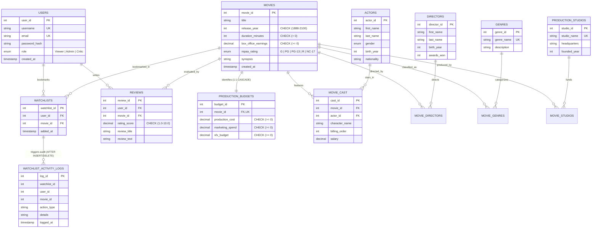

# FilmMatrix — Project Presentation & Evaluation Master Guide
**PES University — Department of Computer Science & Engineering**  
**Course:** UE20CS301: Database Management Systems  
**Mini-Project:** Level 3 Experiential Learning  
**Team Members:** Tanmayi Nagabhairava (`PES1UG24CS493`) & Varsha A Patil (`PES1UG24CS516`) — Section I  

---

## ⚡ 1. EXECUTIVE SYSTEM SUMMARY
> **FilmMatrix** is a dual-engine entertainment database management system. Relational **MySQL** enforces strict financial accounting, budget ledgers, and ACID transactions across 14 normalized tables in 3NF with referential cascade rules. A complementary **Neo4j Graph Database** models multi-hop actor collaboration networks and traverses degrees of separation with constant time $O(1)$ index-free adjacency.

---

## 📐 2. ER DIAGRAM & 14-TABLE RELATIONAL SCHEMA (3NF)

### A. Entity Classifications (14 Tables)

1. **Strong Entities (6 Tables — Independent existence with Primary Key):**
   * **`Users`**: Primary Key: `user_id`. Role-based access control (`Viewer`, `Admin`, `Critic`) with bcrypt hashed credentials.
   * **`Movies`**: Primary Key: `movie_id`. Master film catalog containing titles, release year, duration, MPAA rating, and box office earnings.
   * **`Actors`**: Primary Key: `actor_id`. Hollywood talent roster (25 famous actors, gender, nationality, birth year).
   * **`Directors`**: Primary Key: `director_id`. Filmmakers (8 directors, nationality, awards won).
   * **`Genres`**: Primary Key: `genre_id`. Standardized classification taxonomy (10 genres).
   * **`ProductionStudios`**: Primary Key: `studio_id`. Production companies and distributors (8 studios).

2. **Weak / Identifying Entity (1 Table — Existence depends on identifying owner):**
   * **`ProductionBudgets`**: Depends strictly on `Movies` (1:1 Identifying Relationship). Primary Key: `budget_id`, Foreign Key: `movie_id` references `Movies(movie_id)` with `ON DELETE CASCADE ON UPDATE CASCADE`. Stores production cost, marketing spend, and VFX budget. If a movie is deleted, its budget cannot exist.

3. **Associative / Intersection Entities (6 Tables — Resolving M:N Relationships):**
   * **`MovieCast`**: Resolves M:N between `Movies` and `Actors`. Stores billing order, character roles, and talent salaries.
   * **`MovieDirectors`**: Resolves M:N between `Movies` and `Directors` (supports multi-director projects).
   * **`MovieGenres`**: Resolves M:N between `Movies` and `Genres` (normalizes multivalued genre tags).
   * **`MovieStudios`**: Resolves M:N between `Movies` and `ProductionStudios` (supports co-productions).
   * **`Reviews`**: Resolves M:N between `Users` and `Movies`. Stores critique titles, review text, and numeric rating scores (1.0 to 10.0).
   * **`Watchlists`**: Resolves M:N between `Users` and `Movies`. Manages user bookmark lists.

4. **Audit Log Entity (1 Table — System-generated via Trigger):**
   * **`WatchlistActivityLogs`**: Automatically populated by MySQL `AFTER INSERT` and `AFTER DELETE` triggers. Primary Key: `log_id`. Stores user ID, movie ID, action type (`WATCHLIST_ADD`, `WATCHLIST_REMOVE`), details, and immutable system timestamps.

---

### B. Attributes Breakdown
* **Key Attributes (Primary Keys):**
  * `Users.user_id`, `Movies.movie_id`, `Actors.actor_id`, `Directors.director_id`, `Genres.genre_id`, `ProductionStudios.studio_id`, `ProductionBudgets.budget_id`, `MovieCast.cast_id`, `MovieDirectors.movie_director_id`, `MovieGenres.movie_genre_id`, `MovieStudios.movie_studio_id`, `Reviews.review_id`, `Watchlists.watchlist_id`, `WatchlistActivityLogs.log_id`.
* **Composite / Candidate Keys:**
  * `(user_id, movie_id)` on `Watchlists` and `Reviews` ensures no duplicate entries per user.
  * `(movie_id, actor_id)` on `MovieCast` ensures unique actor-character casting per film.
* **Derived Attributes (Computed dynamically, not redundantly stored):**
  * $\text{Total Investment} = \text{production\_cost} + \text{marketing\_spend}$
  * $\text{Net Profit} = \text{box\_office\_earnings} - \text{Total Investment}$
  * $\text{ROI \%} = \left( \frac{\text{Net Profit}}{\text{Total Investment}} \right) \times 100$
  * *(Computed via View `vw_movie_financial_summary` and Stored Function `fn_calculate_roi`)*
* **Domain / Check Constraints:**
  * `Movies.release_year` $\in [1888, 2100]$
  * `Movies.box_office_earnings` $\ge 0$
  * `Movies.duration_minutes` $> 0$
  * `ProductionBudgets.production_cost` $\ge 0$
  * `ProductionBudgets.marketing_spend` $\ge 0$
  * `Reviews.rating_score` $\in [1.0, 10.0]$
  * `MovieCast.billing_order` $\ge 1$

---

### C. ER Diagram (Mermaid Visual)



---

## ⚡ 3. CODE INVOCATION LINE NUMBERS (Evaluation Checklist)

| Database Stored Object | Object Type | SQL Definition Location | Application Calling Location |
| :--- | :--- | :--- | :--- |
| **`fn_calculate_roi`** | Stored Function | `sql/03_advanced_queries.sql:22` | `sql/03_advanced_queries.sql:60`, `sql/03_advanced_queries.sql:208` |
| **`vw_movie_financial_summary`** | Database View | `sql/03_advanced_queries.sql:50` | `src/app/api/analytics/financial-summary/route.ts:16` |
| **`trg_movies_before_insert`** | BEFORE Trigger | `sql/03_advanced_queries.sql:89` | Fired automatically by MySQL on `INSERT INTO Movies` |
| **`trg_watchlist_after_insert`** | AFTER Trigger | `sql/03_advanced_queries.sql:113` | `src/app/api/watchlists/route.ts:58` |
| **`trg_watchlist_after_delete`** | AFTER Trigger | `sql/03_advanced_queries.sql:133` | `src/app/api/watchlists/route.ts:98` |
| **`sp_register_movie_with_budget`**| Stored Procedure (ACID)| `sql/03_advanced_queries.sql:157`| `src/app/api/movies/route.ts:125` |
| **`sp_calculate_financial_metrics`**| Stored Procedure (Analytics)| `sql/03_advanced_queries.sql:197`| `src/app/api/analytics/stored-procedure/route.ts:20` |

---

## 🔬 4. BEFORE VS AFTER TRIGGER (Core Concept Explanation)

### **A. BEFORE Trigger (`trg_movies_before_insert`):**
* **When it fires:** *Before* the row is physically written to the disk table.
* **Capabilities:** It **can modify** incoming column values using `SET NEW.column_name = ...`.
* **Use Case:** Input sanitization, data normalization, checking domain constraints before persistence.
* **In FilmMatrix:** Strips leading/trailing whitespace from the film title and sets fallback release year if missing.

### **B. AFTER Trigger (`trg_watchlist_after_insert` / `trg_watchlist_after_delete`):**
* **When it fires:** *After* the row has passed all schema constraints and is committed to the disk table.
* **Capabilities:** It **cannot modify** the row (row is already saved).
* **Use Case:** Audit logging, maintaining denormalized tables, creating immutable compliance ledgers.
* **In FilmMatrix:** Automatically writes an audit record into `WatchlistActivityLogs` recording the user ID, movie ID, action type, and server timestamp.

---

## 🌐 5. RELATIONAL (MYSQL) VS GRAPH NOSQL (NEO4J) JUSTIFICATION

### **A. Why Relational MySQL?**
* **Financial Integrity & Compliance:** Movie production budgets, marketing spends, and box office revenues require strict decimal precision and multi-table ACID transactions (`START TRANSACTION ... COMMIT ... ROLLBACK`).
* **Cascade Referential Rules:** With `ON DELETE CASCADE ON UPDATE CASCADE`, deleting a film automatically cleans up its dependent budget, cast mappings, and watchlist entries without leaving orphaned records.

### **B. Why Neo4j Graph NoSQL?**
* **Multi-Hop Traversal Efficiency:** Hollywood talent networks are cyclic, multi-hop graphs. In relational SQL, finding degrees of separation or shared co-stars between two actors requires exponential recursive self-joins taking $O(V^N)$ complexity.
* **Index-Free Adjacency:** Neo4j stores physical pointers directly on nodes and edges. Traversal along relationships takes **$O(1)$ constant time per hop**, regardless of total graph size.

### **C. Key Cypher Query:**
```cypher
MATCH (p1:Actor {name: 'Leonardo DiCaprio'}), 
      (p2:Actor {name: 'Timothée Chalamet'}), 
      path = shortestPath((p1)-[*]-(p2))
RETURN path, length(path);
```
